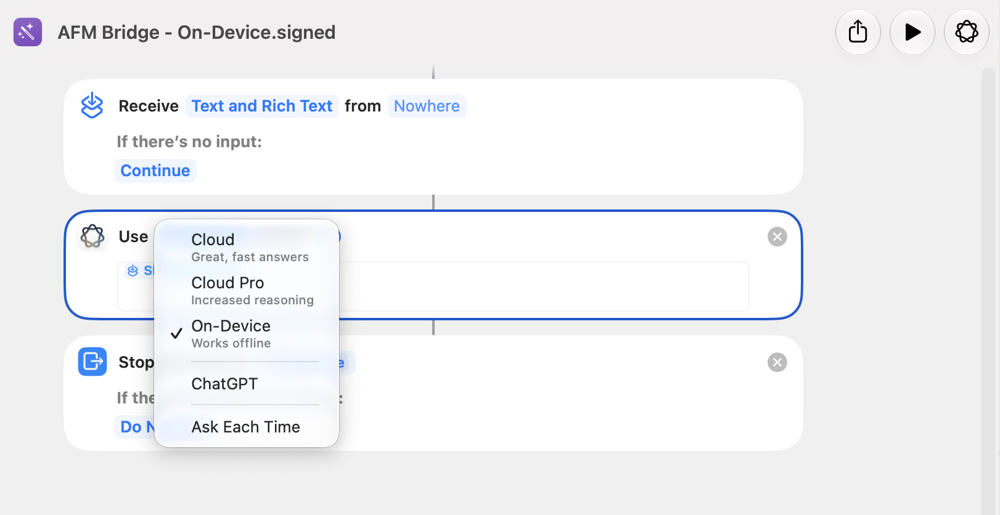

# Capability boundaries and evidence policy

Hollis exposes the separate Cloud and Cloud Pro choices available in Apple's
Shortcuts Use Model action. Existing `on-device` and `auto` routing is unchanged.
The explicit `local` route uses the native Foundation Models SDK independently
of Shortcuts; see [native local](docs/native-local.md).

## What each route promises

- Shortcuts routes return complete responses. They do not expose measured token
  usage, streaming or a native tool channel through Hollis.
- Native local supports incremental text and measured complete-response usage.
  Streaming token usage is not promised.
- A requested route is not an attestation of Apple's private backend version.
- Exact prompt transport does not guarantee a correct answer or acceptance of
  a coding request. The [transport correction](docs/releases/v0.4.0.md) explains
  the scope of the repair.
- Image reference submission does not establish reliable reference-pixel use
  or identity preservation. See [image references](docs/image-references.md).
- Setup and bridge discovery do not prove inference. First-use consent and
  availability depend on the user's Mac and Apple configuration.



This selected product screenshot shows the Cloud, Cloud Pro, On-Device and
ChatGPT picker. It contains no prompt, response or personal account information.

## Dated qualification summary

- **2026-11-01, native local:** Apple Silicon, macOS 27.2 build `26B123`,
  SDK 27.0, source commit `f3cb139`, helper `hollis-native` 0.5.0, protocol 2.
  One plain complete response and one `--schema` response succeeded. The guided
  response was a conforming JSON object and passed independent validation; both
  responses included SDK-measured usage. `doctor` and `models` reported an
  8,192-token context window. No prompt text was found in Hollis state after
  these stateless calls; this does not change persistent chat storage.
- **2026-10-31, Shortcuts:** Cloud and Cloud Pro each succeeded once on the
  merged runtime. Availability and quota guarantees do not follow from these
  checks. The [`fm` comparison](#why-not-fm) records the separate
  Terminal-hosted result and the unmerged prototype's limits.

These checks qualify only the stated setup and calls, not fresh-account consent,
all schema shapes, streaming usage, other OS builds or future availability.
That native run used helper 0.5.0, before the 0.7.0 protocol 4 helper.

## 2026-11-17: published 0.7.1 Local acceptance

This run used only the binaries extracted from the published
[`v0.7.1` runtime bundle](https://github.com/kamenxrider/hollis/releases/tag/v0.7.1),
not a development build or an installed copy. The bundle and release manifest
matched `SHA256SUMS`; GitHub attestations for the bundle, manifest and checksums
verified against source commit `49bd38fa1cd0dc576d0a7df3f6b0093095761c91`,
the release workflow and tag, with `--deny-self-hosted-runners`.
The extracted component hashes also matched the bundle manifest.

| Published asset or extracted component | SHA-256 |
| --- | --- |
| `hollis-0.7.1-darwin-arm64.zip` | `14de97653cbed6a6fc44791e136bfcdadd31c2bc360bd999dcfbb263332dd989` |
| `hollis` (`hollis-darwin-arm64`) | `82d35d63c0c0851cd7042dd248e756de23bc790e8bcef9ed065cfb58794d2583` |
| `hollis-native` (`hollis-native-darwin-arm64`) | `b31fe021dd3bd7feb8bc5656762794aeb34ab795921bcc7bcb418a5165f94ad8` |
| `hollis-bridges.zip` (not imported or run) | `e6834df5e9717633c626132996df30308551b3040fe3bd370b100b6901c81f61` |
| `release-manifest.json` | `8e0ef9a7559182ebd036e8625e07cc71dbcb6cefbb085bdc640c677ea8c5003a` |

Host: `sw_vers -productVersion` reported `27.3`;
`sw_vers -buildVersion` reported `26C5035r`; hardware model `Mac16,8`,
chip `Apple M4 Pro`. Version commands returned `hollis 0.7.1`,
`hollis-native 0.7.1`, and helper protocol `4`.

`doctor --model local --json` exited 0 before any inference. It reported
`status: ready`, `reason_code: prerequisites_ready`, Local `available: true`,
`context_size: 8192`, helper `0.7.1`/protocol `4`, and guided output, tools
and one-image support. Its message was
“Observed setup prerequisites are ready; inference has not been tested.”
`inference_tested` and `inference_verified` were false;
`artifact_verification` was `unknown`. That observation is not the separate
checksum/attestation verification above.

Each check below had one attempt, in order, without retries. CLI requests used
explicit `--model local --timeout 120s --retry=0 --stream=false --json`;
an outer 125-second process deadline also applied. HOME and
`HOLLIS_STATE_DIR` were temporary. The process sandbox denied network access,
real Shortcuts/open execution, and access to the owner's Hollis state.

| Check | Result | Observed output |
| --- | --- | --- |
| Plain Local inference | **PASS** (exit 0, 1.152 s) | Response `HOLLIS_READY`; requested and used model both `local`, `attempts: 1`. |
| Guided JSON, `--schema` plus `--json` envelope | **FAIL** (exit 5, 0.632 s) | `request_declined`: “Apple asked for a different description; the underlying reason was not specified.” No structured response was returned. |
| Local tool calling | **PASS** (exit 0, 1.678 s) | One allowlisted `fixture__constant` MCP call, arguments `{}`, `executed: true`, completed without error; final response `HOLLIS_CONSTANT_42`, `attempts: 1`. |
| Fabricated PNG image input | **PASS** (exit 0, 1.221 s) | Response `HOLLIS 42`, matching the rendered text; requested and used model both `local`, `attempts: 1`. |
| Fabricated scanned PDF, model-free extraction | **FAIL** (exit 0, 31.262 s) | Helper completed one page with `method: ocr`, but returned `1- 5110H` (8 bytes), not `HOLLIS 42`. Successful extraction transport did not establish correct recognition. |

The guided schema required an object with string `label` and integer `number`,
with no extra properties; the fabricated prompt asked for `HOLLIS` and `42`.
Its exact error document was:

```json
{"error":{"code":"request_declined","exit_code":5,"message":"Apple asked for a different description; the underlying reason was not specified."}}
```

The corresponding diagnostic identified
`FoundationModels.LanguageModelError`, domain of the same name, code `2`,
`callback_captured=true`; it did not identify the refusal's underlying reason.
`--format json` was not run: it is documented as unsupported on Local;
`--schema` with the `--json` envelope is the documented guided path.

The local stdio MCP fixture exposed only an empty-argument constant-returning
tool, with no network or filesystem writes. Its definition was reviewed and
pinned in temporary state before the single tool request. The PNG used
fabricated block-letter text. The one-page PDF contained only a raster of that
text, no text layer; independent rendering confirmed that it was upright.
PDF extraction used the published helper's protocol-4 `extract` operation
directly, without model generation. No failed check was retried or repaired.

These results qualify only these inputs on this host and build, not general
guided-output reliability, OCR accuracy, first-account consent, streaming,
other OS versions or future availability. No Cloud, Cloud Pro, ChatGPT,
On-Device, PCC or image-generation route ran; no Shortcuts ran or were imported.
Nothing was installed and owner Hollis state was not used. Temporary binaries,
fixtures and state were removed after recording the results.

## Why not `fm`?

On macOS 27.0 build **26A428**, Apple’s installed `fm --help` and `fm respond --help`
listed only the on-device `system` model. That historical CLI observation does
not describe every `fm` surface: in 2026-10-31 tests, `fm serve` PCC requests
succeeded only from an interactive Terminal-hosted process; tested noninteractive
and background-Terminal contexts were refused. Hollis's `fm` route remains an
unmerged draft prototype ([#62](https://github.com/kamenxrider/hollis/pull/62)),
not an available route as of 2026-11-01.

Hollis exposes separate Cloud and Cloud Pro choices through Shortcuts; each
succeeded once on the merged runtime on 2026-10-31. These are scoped checks,
not a guarantee of continued cloud availability.
Joseph Humfrey demonstrated the Shortcut-to-PCC approach in
[*The Shortcut to integrating Private Cloud Compute into my app*](https://joethephish.me/blog/the-shortcut-to-integrating-PCC/);
Hollis adds explicit selection, CLI/API access, conversations and batches.
## What belongs in a release

Public source includes implementation, user documentation, selected product
artwork and synthetic regression tests. Live research harnesses, per-call
records, actual model answers, host transcripts, recorded demo runs and internal
review reports stay private. Publishing any of that material requires separate
content review and authorization.

The [publication gate](scripts/release/README.md) checks an explicitly reviewed
source manifest and the actual package contents. Public runtime checksums and
build provenance describe the artifacts; they do not replace live qualification.
[Testing documentation](docs/testing.md) describes the provider-free checks.

## Related public surfaces

Apple's Foundation Models framework and its Shortcuts automation surface have
different contracts. Framework capabilities must not be attributed to a
Shortcuts route without demonstrating them there. Hollis does not claim to have
invented calling Apple Intelligence through Shortcuts or to be the first Apple
Foundation Models CLI.

- [Apple Foundation Models framework](https://developer.apple.com/documentation/foundationmodels)
- [Apple: Introducing the Third Generation of Apple's Foundation Models](https://machinelearning.apple.com/research/introducing-third-generation-of-apple-foundation-models)
- [Apple Support: Run shortcuts from the command line](https://support.apple.com/guide/shortcuts-mac/run-shortcuts-from-the-command-line-apd455c82f02/mac)
- [Joseph Humfrey: The Shortcut to integrating Private Cloud Compute into my app](https://joethephish.me/blog/the-shortcut-to-integrating-PCC/)
