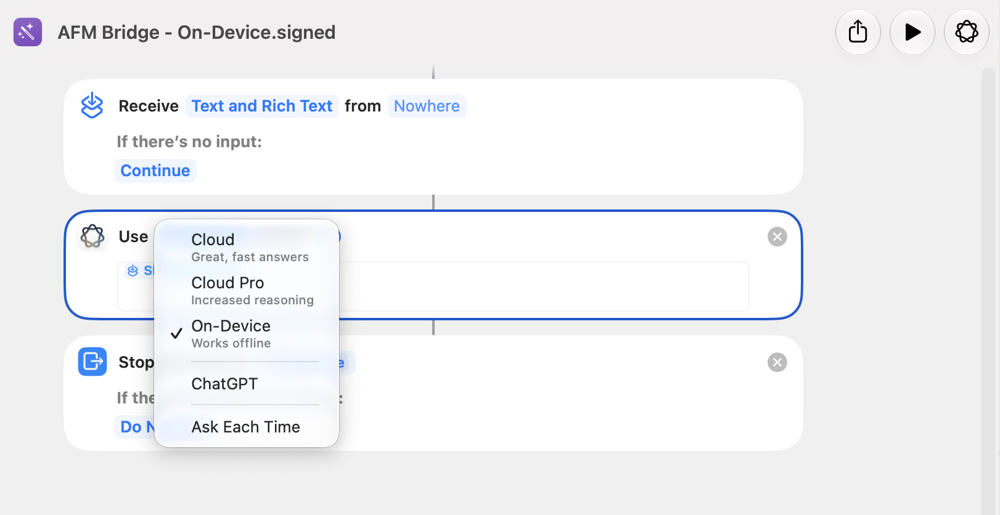

<picture>
  <source media="(prefers-color-scheme: dark)" srcset="docs/assets/hollis-logo-dark.svg">
  
</picture>

**Apple Intelligence’s Cloud and Cloud Pro models in your terminal, scripts and AI agents.**

Hollis brings Apple’s model choices to your command line and your agents. No
model API key, no account to create and no per-request charge from Hollis.

- **Apple’s Cloud and Cloud Pro models.** Two distinct Private Cloud Compute
  selections from Shortcuts’ **Use Model** action, chosen explicitly and never
  silently switched.
- **On-device answers with `local`.** Apple’s native Foundation Models SDK on
  your Mac: offline, streaming in the terminal, with guided JSON output.
- **Image generation.** Animation, Illustration, Sketch, Genmoji and Any Style,
  saved as PNG files, from the terminal, a chat or the API.
- **Saved chats.** Conversations stay on your Mac and can be continued and searched.
- **Batch processing.** A folder of documents or images with a preview, a call
  budget and resumable progress.
- **An agent plugin** for Claude Code and Codex, and an OpenAI-compatible API on
  localhost for other clients.

```bash
hollis respond --model local "Explain a race condition briefly"  # streams output
hollis respond "Explain closures in Go in three sentences"
hollis respond --model cloud-pro --file README.md "Summarize this document"
hollis respond --image photo.jpg "Describe this image"
cat prompt.txt | hollis respond
hollis chat                          # remembers the conversation
hollis image generate "A red sailboat" --style illustration --output boat.png
```

<!-- SCREENSHOT PLACEHOLDER: replace with a real terminal screenshot of a
`hollis respond --model local` run before release. Do not use a mock-up. -->

**Choose your setup:** [CLI](#quick-start) ·
[Claude Code / Codex plugin](plugins/hollis/README.md#install) ·
[What leaves your machine](#what-leaves-your-machine) ·
[Limits and caveats](#limits-and-caveats)

## Requirements

Check these before installing:

- An **Apple-silicon Mac** running **macOS 27**. macOS 26 is untested, and
  Intel Macs do not support Apple Intelligence inference
  ([compatibility](docs/compatibility.md)).
- **Apple Intelligence** enabled in *System Settings → Apple Intelligence &
  Siri*, with its model downloads complete.
- [GitHub CLI](https://cli.github.com/) (`gh`) for the installer’s download
  verification. Plugin setup does not require it.
- Network access for Cloud, Cloud Pro and ChatGPT. On-Device and native local
  work offline.
- For ChatGPT, enable the extension in *System Settings → Apple Intelligence & Siri*.
- Complete Apple’s first-use approvals. Image generation needs an unlocked Mac.

<a id="quickstart"></a>
<a id="install-verified"></a>
<a id="install"></a>

## Quick start

Start with `local`: it runs on your Mac and needs no Shortcut import. Using
Claude Code or Codex? Start with the [plugin installation](plugins/hollis/README.md#install) instead.

**1. Install.** The installer verifies the published ARM64 bundle’s checksum
and GitHub build provenance, then installs `hollis` with its matching native
helper in `~/.local/bin`. It makes no model calls and needs no `sudo`.

```bash
curl -fsSLo install-hollis.sh https://raw.githubusercontent.com/kamenxrider/hollis/main/scripts/install.sh && \
  bash install-hollis.sh
export PATH="$HOME/.local/bin:$PATH"
```

Add `~/.local/bin` to your shell’s PATH permanently if needed. Inspect the
[installer](scripts/install.sh) first, or [verify manually](#verification-and-trust).

**Homebrew:** a Homebrew formula is coming with the release. Until then, use
the installer above.

**2. Check native local and ask.**

```bash
hollis models --model local
hollis respond --model local "Reply with OK"
```

`models --model local` checks only native availability, without Shortcuts
discovery; a successful answer checks inference. If the model is not ready,
check that Apple Intelligence is enabled and its downloads are complete. Newer
runtimes also provide `hollis doctor --model local`, a route-scoped check with
its own exit status ([selected-route diagnostics](docs/selected-route-setup.md));
the installed 0.4.0 runtime does not have it yet.

<a id="add-shortcuts"></a>

**3. Add the Shortcuts routes.** Cloud, Cloud Pro, On-Device, ChatGPT and image
generation run through Shortcuts. The installer opens five imports: choose
**Add Shortcut** for each of the four model bridges (Cloud, Cloud Pro,
On-Device, ChatGPT) and **Hollis Image - Reference Input v2**. When updating an
older image bridge, replace it with this version. The installer configures the
bundled image bridge only when no general image bridge is set; custom settings
are preserved. The first request may also require Apple’s **Allow** approval.

```bash
hollis doctor
hollis respond "Reply with OK"
```

`doctor` checks setup and availability for every route, and reports missing
bridges even when native local works.

**Upgrading?** A newer release may upgrade local chat storage to a schema that an
older binary cannot read, and switching back does not undo that upgrade. Close
older Hollis processes, including `hollis serve`, first and read the
[database upgrade and recovery steps](docs/cli.md#database-upgrades-and-recovery).

## Models

Five model choices: four through Shortcuts, one native. `auto` is a routing strategy.

| You type | Runs through | Notes |
| --- | --- | --- |
| `cloud` | Shortcuts → Private Cloud Compute | Apple’s “Great, fast answers” selection |
| `cloud-pro` | Shortcuts → Private Cloud Compute | Apple’s “Increased reasoning” selection |
| `on-device` | Shortcuts → your Mac | Works offline; complete responses |
| `local` | Native SDK → your Mac | Text-only; streams in a terminal; measured usage on complete responses; `--schema` and HTTP guided JSON output (current source, not in pinned 0.4.0) |
| `chatgpt` | Shortcuts → Apple’s ChatGPT extension | Not an Apple model |
| `auto` | Cloud, then Shortcuts On-Device | Default; one fallback only for a confirmed missing bridge or recognized Cloud rate limit |

Cloud and Cloud Pro are distinct selections in Shortcuts’ **Use Model** action.
Apple does not publish stable backend model IDs for these choices.



```bash
hollis models
hollis config set model cloud-pro
```

## What leaves your machine

Hollis reads only what you supply with an argument, `--prompt-file`, `--file`,
`--image`, stdin, the API or your agent. It does not read your workspace on its
own. Where the request goes depends on the route you select.

| Route or feature | Where your prompt and attachments go |
| --- | --- |
| `local` | Stays on your Mac. Apple’s on-device model runs through the native SDK. |
| `on-device` | Stays on your Mac. Shortcuts runs Apple’s on-device model selection. |
| `cloud`, `cloud-pro` | Apple’s Private Cloud Compute, through Shortcuts. The rendered prompt, attached document text, chat history being replayed and images are sent. |
| `chatgpt` | Apple’s ChatGPT extension sends the request to ChatGPT under that extension’s terms. |
| `auto` | Cloud first; at most one fallback to Shortcuts On-Device. Never native local. |
| Image generation | Apple’s Image Playground, through your image Shortcut, with the prompt and any reference image. Apple decides where Image Playground processes the request; Hollis has not measured it. |
| PDF input (current source, not runtime 0.4.0) | The helper extracts text on your Mac. Extracted text, not PDF bytes, travels with the prompt to whichever route answers, including Cloud, Cloud Pro and ChatGPT; `auto` follows its routing policy. Extraction alone does not make the request local. |
| `hollis serve` | Listens on `127.0.0.1` by default. Requests go to the route they name, as above. |
| Agent plugin | Your agent host sees the context it sends and Apple’s answer. A cloud-hosted agent’s provider receives that too, under its own privacy policy. |

<!-- Release step: when MCP tools ship, add a row stating what the shipped
code sends, and to which server or route. -->

Configuration, chats and run history stay in a local state directory
([your data](#your-data-and-uninstalling)). Prompts use private temporary files,
removed after requests.

## Everyday use

### Documents and chats

```bash
hollis respond --prompt-file instructions.txt
hollis respond --file first.md --file second.txt "Summarize the differences"
hollis respond --file report.pdf --pages 1,4-6 "Summarize these pages"
hollis chat
hollis chat --continue <id> "What did we decide?"
hollis chats list
```

Attach UTF-8 text files of any extension, or PDFs. A PDF is read on this Mac by the
paired native helper, from its text layer with OCR for pages that have none;
`--pages` selects pages of a single PDF. Extraction is CLI-only, not an HTTP
feature. The extracted page text, not the PDF bytes, goes to whichever answering
route you select, including cloud, cloud-pro, or ChatGPT. Use `--model local`
to keep the answer generation on this Mac too. Each `respond` call is
stateless. Chats store and replay the conversation. The complete rendered prompt
must fit 128 KiB; oversized requests and native context-capacity failures produce
errors without silently shortening history. Default timeout is 30 seconds, with a
120-second ceiling. [CLI and data guide](docs/cli.md).

### Image generation and understanding

```bash
hollis image generate "A brass turtle carrying a tiny greenhouse" \
  --style illustration --output turtle.png
hollis image generate "A lighthouse at sunset" \
  --style sketch --aspect-ratio 16:9 --fit crop --output banner.png
hollis respond --model cloud-pro --image a.png --image b.png "Compare them"
```

Generation saves a PNG to a new filename in an existing folder. Animation,
Illustration, Sketch, Genmoji and Any Style returned images in tests. Ratios and
sizes use local crop/pad/resize after generation.

For image understanding, Cloud and Cloud Pro accept up to three PNG/JPEG images;
ChatGPT accepts one. Native local is text-only. `auto` and Shortcuts On-Device reject
image input because the tested On-Device Shortcut ignored the pixels.
[Images and styles](docs/image-generation.md) · [References and follow-ups](docs/image-references.md).

### Batch processing

```bash
hollis batch plan --input-dir ./inbox --prompt-file instructions.txt \
  --model cloud --output-dir ./results --job ./job.json
hollis batch run --job ./job.json --max-calls 12
hollis batch resume --job ./job.json --max-calls 12
```

Planning makes no model calls. Runs have an explicit call budget and verify
saved results before skipping them. Cloud and ChatGPT calls wait at least 15
seconds after each completion and Cloud Pro waits 45 seconds; On-Device and
native local run without a pause. Text supports all five
explicit model choices; images use Cloud, Cloud Pro or ChatGPT. `auto` is not a
batch choice. A failure stops the run. [Batch guide](docs/batch.md).

## Use Hollis in Claude Code and Codex

The [plugin](plugins/hollis/README.md) bundles runtime **0.4.0**, its matched
native helper and five Shortcut bridges. Ask Apple to assess a supplied plan,
compare documents or create an image, then keep working in the same
conversation. Guided setup preserves your existing configuration and
conversations.

Plugin release 0.2.0 was withdrawn, so install from main until a versioned
release follows. Plugin 0.1.0 bundled runtime 0.3.3 and does not include native
local; update the plugin to get it.
[Installation and everyday requests](plugins/hollis/README.md#install).

## OpenAI-compatible API

Chat Completions and Responses run on localhost. First create private authentication
files and start the server:

```bash
umask 077
openssl rand -base64 48 > hollis.token
{ printf 'Authorization: Bearer '; cat hollis.token; } > hollis.headers
hollis serve --token-file hollis.token
```

In another terminal in the same directory:

```bash
curl -sS http://127.0.0.1:1978/v1/chat/completions \
  -H @hollis.headers -H 'Content-Type: application/json' \
  -d '{"model":"cloud","stream":false,"messages":[{"role":"user","content":"Explain closures briefly."}]}'
```

- Through Shortcuts, answers are complete and token usage is unavailable; `stream: true` returns 400.
- Native `local` supports real SSE streaming on both endpoints and measured token usage on complete responses. Streaming usage is not promised.
- Guided JSON output on `local` is available through `--schema` on the CLI and through `response_format` / `text.format` on both HTTP endpoints. It is current source, not in the pinned 0.4.0 runtime, and the object is returned as a JSON string.
- A paired native helper that speaks another protocol or version is 502 `native_protocol` on `local` requests, guided or plain, matching CLI exit 5 and naming the matching bundle; a missing or unavailable helper stays 400 `model_unavailable`.
- CLI `--json` and `--agent` output never stream; explicit streaming with either is rejected.
- No API tools/function calls. `system` and `instructions` are advisory prompt content.

[Client settings, authentication and limits](docs/api.md) · [Native local](docs/native-local.md).

<a id="cloud-availability-and-limits"></a>

## Limits and caveats

### Cloud availability

Apple controls Cloud and Cloud Pro availability and usage limits. During testing,
we encountered an explicit Cloud Pro usage limit and hours-long interruptions to
cloud access before it recovered. Some failures returned generic Shortcuts errors;
not every interruption was a confirmed quota hit.

Hollis cannot show your remaining Shortcuts allowance or predict when access will
recover. Pacing reduces bursts; it does not guarantee availability or prevent a
usage limit. Pause after a limit rather than repeatedly retrying. No fixed reset
interval, shared quota, or safe calls-per-minute allowance has been established.

Explicit `cloud` and `cloud-pro` requests never silently switch models. Default
`auto` may try Shortcuts On-Device once after a recognized Cloud limit or confirmed
missing bridge. It never falls back to native local.

Hollis requires no model API key and adds no inference charge. Apple’s limits and
any charges from your agent host or linked service still apply.

### Image generation

On the tested, already approved account, generation needed no per-image click or
visible Playground editor. Any Style does not guarantee photographs; ChatGPT
image generation is unavailable through the tested Shortcut. Reference bytes are
sent, but reliable use of their pixels, including subject preservation, remains
unproven.

### Versions

Current-source additions (`--schema`, HTTP guided JSON output, protocol-2
context diagnostics, PDF extraction and `doctor --model`) are not in the pinned runtime 0.4.0
or the plugin built from main. See
[native-local version requirements](docs/native-local.md#guided-output).

## Verification and trust

The binaries are not Developer ID signed or notarized. The installer’s checksum
and GitHub build-provenance checks establish their release origin; for the
smallest trust chain, build from source
([other install routes](docs/compatibility.md#other-install-routes)). To run the
installer’s checks yourself:

<a id="verified-install-step-by-step"></a>

<details>
<summary>Verify manually</summary>

These commands perform the installer’s checks and install the same matched
0.4.0 bundle. The last command selects the bundled image bridge; skip it if you
already use a custom image bridge. Do not install a bundle that fails either
the checksum or the attestation check.

```bash
(
set -euo pipefail
umask 077
HOLLIS_VERSION=0.4.0
HOLLIS_BUNDLE="hollis-$HOLLIS_VERSION-darwin-arm64.zip"
cd "$(mktemp -d)"
gh release download "v$HOLLIS_VERSION" --repo kamenxrider/hollis \
  --pattern "$HOLLIS_BUNDLE" --pattern SHA256SUMS
awk -v asset="$HOLLIS_BUNDLE" '$2 == asset { n++; print } END { if (n != 1) exit 1 }' \
  SHA256SUMS > SELECTED_SHA256SUMS
shasum -a 256 -c SELECTED_SHA256SUMS
gh attestation verify "$HOLLIS_BUNDLE" --repo kamenxrider/hollis \
  --signer-workflow kamenxrider/hollis/.github/workflows/release.yml \
  --source-ref refs/tags/v0.4.0 \
  --source-digest 1906721a1cd5594ce47be6d4d306d7daa1e6891f \
  --deny-self-hosted-runners
unzip -q "$HOLLIS_BUNDLE" -d runtime
mkdir -p "$HOME/.local/bin"
install -m 755 runtime/hollis runtime/hollis-native "$HOME/.local/bin/"
unzip -q runtime/hollis-bridges.zip -d bridges
mkdir signed
for f in bridges/*.shortcut; do
  shortcuts sign --mode anyone --input "$f" --output "signed/${f##*/}"
  open "signed/${f##*/}"
done
)
export PATH="$HOME/.local/bin:$PATH"
hollis config set image-bridge "Hollis Image - Reference Input v2"
```

</details>

`doctor` and `setup` check setup and availability, never inference. Verified
downloads and existing-account tests do not establish fresh-account onboarding.
Dated live checks and what they qualify are in [Evidence](EVIDENCE.md), which
also compares Hollis with Apple’s own [`fm` tool](EVIDENCE.md#why-not-fm).

<a id="your-data"></a>

## Your data and uninstalling

Configuration (`config.json`), conversations and run history (`hollis.db`) live in
`~/Library/Application Support/hollis`, unless `HOLLIS_STATE_DIR` overrides it.
The plugin keeps its managed runtime under that directory’s `plugin` folder.
Prompts use private temporary files, removed after requests; abrupt termination can
leave files behind. [Transport and cleanup](docs/shortcuts.md#how-it-works).

For the CLI installer above, remove the executables:

```bash
rm -i "$HOME/.local/bin/hollis" "$HOME/.local/bin/hollis-native"
```

For an earlier `/usr/local/bin` install, remove those copies instead. Remove the
plugin through its host’s plugin manager. Delete the five Hollis shortcuts in
Shortcuts if no remaining installation uses them. Your chats and settings remain;
to erase them too, delete the Hollis Application Support folder in Finder after
backing up anything you want to keep. [Plugin state and removal](plugins/hollis/docs/setup.md).

## Reference

<!-- Preserved anchors: external deep links from release notes and EVIDENCE.md. Do not remove. -->
<a id="scripts-and-agents"></a>
<a id="quick-reference"></a>
<a id="local-openai-shaped-api"></a>
<a id="inline-image-input"></a>
<a id="clients-listing-is-not-the-same-as-working"></a>
<a id="generate-an-image-through-the-api"></a>
<a id="how-it-works"></a>
<a id="bridge-discovery"></a>
<a id="shortcuts-quirks-hollis-handles"></a>
<a id="the-chatgpt-quirk"></a>
<a id="model-notes"></a>
<a id="doctor"></a>
<a id="compatibility"></a>
<a id="other-install-routes"></a>
<a id="what-you-need"></a>
<a id="if-something-breaks"></a>
<a id="testing"></a>
<a id="why-not-fm"></a>


| Guide | What you will find |
| --- | --- |
| [CLI and local data](docs/cli.md) | Inputs, chats, agent JSON, storage and exit codes |
| [Selected-route setup](docs/selected-route-setup.md) | `hollis setup` and `doctor --model <route>` plans, statuses and exit codes |
| [API](docs/api.md) | Chat Completions, Responses, and why a listed model can still fail |
| [Shortcuts transport](docs/shortcuts.md) | Bridge discovery and measured behavior |
| [Compatibility](docs/compatibility.md) | Tested builds, doctor, verified and alternative installation |
| [Testing](docs/testing.md) | Offline checks and live-test boundaries |
| [Contributing](CONTRIBUTING.md) | Building, offline checks and the privacy gate |
| [AI pull-request review](scripts/ai-review/README.md) | Bounded diff review, provider configuration and the manual smoke run |

<a id="whats-in-031"></a>
<a id="included-from-030"></a>

[Release notes](docs/releases/README.md) · [Evidence](EVIDENCE.md) · [Apache-2.0 license](LICENSE)
