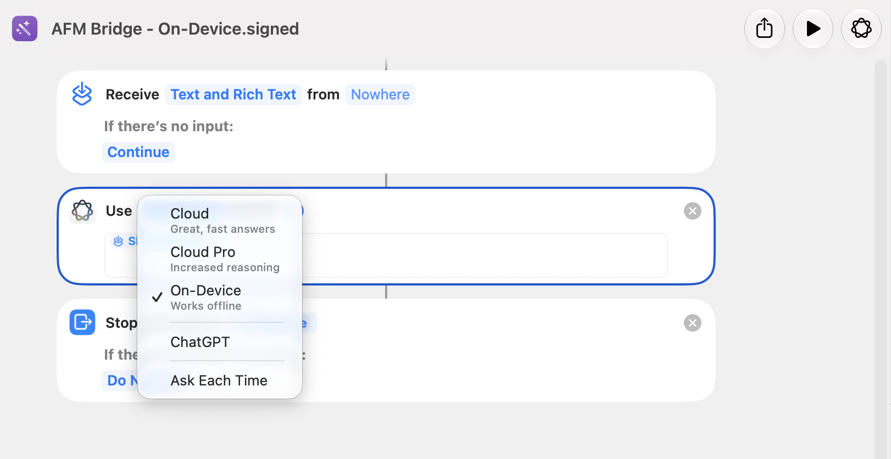

# Features and reference

**Apple Intelligence’s Cloud and Cloud Pro models in your terminal, scripts and AI agents.**

Use Apple’s model choices from your command line and agents. Hollis requires
no model API key or new account and has no per-request charge.

- Apple’s Cloud and Cloud Pro models: two distinct Private Cloud Compute
  selections from Shortcuts’ **Use Model** action, chosen explicitly and never
  silently switched.
- On-device answers with `local`. Apple’s native Foundation Models SDK on
  your Mac: offline, streaming in the terminal, with guided JSON output, one
  image per request and tool calling.
- PDFs and scans: text and OCR extraction on your Mac before any model sees
  the document.
- Image generation: Animation, Illustration, Sketch, Genmoji and Any Style,
  saved as PNG files, from the terminal, a chat or the API.
- Saved chats stay on your Mac. You can continue and search them.
- Batch processing handles a folder of documents or images with a preview,
  a call budget and resumable progress.
- An agent plugin for Claude Code and Codex, and an OpenAI-compatible API on
  localhost for other clients.

```bash
hollis respond --model local "Explain a race condition briefly"  # streams output
hollis respond "Explain closures in Go in three sentences"
hollis respond --model cloud-pro --file README.md "Summarize this document"
hollis respond --image photo.jpg "Describe this image"
cat prompt.txt | hollis respond
hollis chat                          # remembers the conversation
hollis image generate "A red sailboat" --style illustration --output boat.png
```

Local-only `respond` and `chat` accept opt-in `--retry` (3 extra attempts) or
`--retry=N` (0 to 5); retry is off unless supplied. Cloud, Cloud Pro, on-device,
ChatGPT, auto and image generation are never retried.

## What's new in 0.7.0

- [`-s` / `--system-file`](cli.md#instructions-one-shot-conversations-and-local-checks): inline instructions or an instruction file.
- [`--messages`](cli.md#instructions-one-shot-conversations-and-local-checks): pass a one-shot conversation, including host context.
- [`-q`](cli.md#instructions-one-shot-conversations-and-local-checks): hide notes and progress, not answers or errors.
- [`--count-tokens`](cli.md#instructions-one-shot-conversations-and-local-checks): check Local input fit without generating.
- [`--permissive`](cli.md#instructions-one-shot-conversations-and-local-checks): opt-in Local text transformations; refusals remain possible.
- [`--retry`](cli.md#opt-in-local-retry): opt into bounded retries for transient Local busy failures only.
- [`--context-strategy`](cli.md#opt-in-conversation-shortening): explicitly shorten a request without changing stored history.
- [`benchmark`](cli.md#local-speed-test): measure Local speed with fixed prompts and serial calls.
- [`update`](cli.md#checking-for-updates): explicitly check for a stable release and get upgrade guidance.
- [`stream_options`](api.md#chat-completions-app-compatibility): request a final Local stream usage chunk.
- [`json_object`](api.md#guided-json-output): validated, complete-only JSON on Local (guided output) and Shortcut routes (JSON bridges plus validation).
- [`n` / `logprobs` / `user`](api.md#chat-completions-app-compatibility): accept single-answer, disabled-probability and ignored-label client fields.

JSON requests on Shortcut routes use four `AFM Bridge JSON - <Route>`
Dictionary bridges. On success, `respond --format json` and API `json_object`
return one validated JSON object; invalid output fails explicitly with
`invalid_json_output`. A request can still fail or return wrong data.
Shortcut routes do not enforce requested fields, types or values: models may
add keys, use `false` or `"null"` instead of null, nest answers or change
punctuation. Local `--schema` constrains structure and types to the supported
schema subset, not factual correctness.
`hollis setup --import cloud` imports both Cloud bridges; missing JSON bridges
retain text behavior with an import hint. See [JSON output](cli.md#json-object-responses).
Shortcuts may spell 19.95 as `19.949999999999999`; Hollis preserves that spelling,
so financial or exact-decimal callers should use decimal strings or round explicitly.

## Model details

Five model choices: four through Shortcuts, one native. `auto` is a routing strategy.

| You type | Runs through | Notes |
| --- | --- | --- |
| `cloud` | Shortcuts → Private Cloud Compute | Apple’s “Great, fast answers” selection |
| `cloud-pro` | Shortcuts → Private Cloud Compute | Apple’s “Increased reasoning” selection |
| `on-device` | Shortcuts → your Mac | Works offline; complete responses |
| `local` | Native SDK → your Mac | Text and one PNG/JPEG image; streams in a terminal; measured usage on complete responses; `--schema` and HTTP guided JSON output; caller tools and MCP tools |
| `chatgpt` | Shortcuts → Apple’s ChatGPT extension | Not an Apple model; enable the extension in System Settings → Apple Intelligence & Siri |
| `auto` | Cloud, then Shortcuts On-Device | Default; one fallback only for a confirmed missing bridge. Provider limits stop without retry or fallback |

Cloud and Cloud Pro are distinct selections in Shortcuts’ **Use Model** action.
Apple does not publish stable backend model IDs for these choices.



```bash
hollis models
hollis config set model cloud-pro
```

## Everyday use

### Documents and chats

```bash
hollis respond --prompt-file instructions.txt
hollis respond --file first.md --file second.txt "Summarize the differences"
hollis respond --file report.pdf --pages 1,4-6 "Summarize these pages"
hollis chat
hollis chat --continue <id> "What did we decide?"
hollis chats list
```

Attach UTF-8 text files of any extension, or PDFs. The paired native helper reads
a PDF on this Mac from its text layer, with OCR for pages that have none;
`--pages` selects pages of a single PDF. Extraction is CLI-only, not an HTTP
feature. The extracted page text, not the PDF bytes, goes to whichever answering
route you select, including cloud, cloud-pro, or ChatGPT. Use `--model local`
to keep the answer generation on this Mac too. Each `respond` call is
stateless. Chats store and replay the conversation. The complete rendered prompt
must fit 128 KiB; oversized requests and native context-capacity failures produce
errors without silently shortening history. Default timeout is 30 seconds, with a
120-second ceiling. [CLI and data guide](cli.md).

Opt in to request-only shortening with `chat --context-strategy drop-oldest`
(also `sliding-window` or Local-only `summarize`); `respond --messages` supports
the same policies. Stored history is unchanged and every drop is disclosed.

### Image generation and understanding

```bash
hollis image generate "A brass turtle carrying a tiny greenhouse" \
  --style illustration --output turtle.png
hollis image generate "A lighthouse at sunset" \
  --style sketch --aspect-ratio 16:9 --fit crop --output banner.png
hollis respond --model cloud-pro --image a.png --image b.png "Compare them"
```

Generation saves a PNG to a new filename in an existing folder. Animation,
Illustration, Sketch, Genmoji and Any Style returned images in tests. Ratios and
sizes use local crop/pad/resize after generation.

For image understanding, Cloud and Cloud Pro accept up to three PNG/JPEG images;
ChatGPT accepts one. Native local accepts one PNG/JPEG on macOS 27 with a
vision-capable model, including streaming; tools and guided output cannot be
combined with images. `auto` and Shortcuts On-Device reject
image input because the tested On-Device Shortcut ignored the pixels.
[Images and styles](image-generation.md) · [References and follow-ups](image-references.md).

### Batch processing

```bash
hollis batch plan --input-dir ./inbox --prompt-file instructions.txt \
  --model cloud --output-dir ./results --job ./job.json
hollis batch run --job ./job.json --max-calls 12
hollis batch resume --job ./job.json --max-calls 12
```

Planning makes no model calls. Runs have an explicit call budget and verify
saved results before skipping them. After each completion, Cloud waits at least
30 seconds, Cloud Pro 45 seconds and ChatGPT 15 seconds; On-Device and native
local run without a pause. Apple rate-limits cloud requests per Mac without
publishing the limit; we observed a block of about 17 to 24 hours after roughly
115 Cloud requests in 34 minutes. Pacing reduces risk but cannot guarantee
access. Text supports all five
explicit model choices; images use Cloud, Cloud Pro or ChatGPT. `auto` is not a
batch choice. A failure stops the run. [Batch guide](batch.md).

## Agent plugin

Plugin 0.4.0 targets runtime 0.7.0, its matched helper and nine bridges. Ask Apple to assess a supplied plan, compare documents or create an image, then continue in the same conversation. Guided setup preserves existing configuration and chats. See the [plugin quick start](../plugins/hollis/docs/quickstart.md).

Plugin 0.2.0 was withdrawn. Plugin 0.1.0 bundled runtime 0.3.3 without native local.

## OpenAI-compatible API

Chat Completions and Responses run on localhost. First create private authentication
files and start the server:

```bash
umask 077
openssl rand -base64 48 > hollis.token
{ printf 'Authorization: Bearer '; cat hollis.token; } > hollis.headers
hollis serve --token-file hollis.token
```

In another terminal in the same directory:

```bash
curl -sS http://127.0.0.1:1978/v1/chat/completions \
  -H @hollis.headers -H 'Content-Type: application/json' \
  -d '{"model":"cloud","stream":false,"messages":[{"role":"user","content":"Explain closures briefly."}]}'
```

- Through Shortcuts, answers are complete and token usage is unavailable; `stream: true` returns 400.
- Native `local` supports real SSE streaming on both endpoints and measured token usage on complete responses. Chat Completions can request a final usage chunk with `stream_options`; unavailable counts stay null.
- Guided JSON output on `local` is available through `--schema` on the CLI and through `response_format` / `text.format` on both HTTP endpoints. The object is returned as a JSON string.
- If the paired native helper speaks another protocol or version, Hollis returns 502 `native_protocol` for `local` requests, guided or plain. This matches CLI exit 5 and names the matching bundle. A missing or unavailable helper stays 400 `model_unavailable`.
- CLI `--json` and `--agent` output never stream; explicit streaming with either is rejected.
- Caller-provided tools on `local` only (`tools`, `role:"tool"` / `function_call_output` results, `finish_reason:"tool_calls"`); Hollis never runs a tool. `system` and `instructions` are advisory prompt content.

[Client settings, authentication and limits](api.md) · [Native local](native-local.md).

## Limits and caveats

### Cloud availability

Apple controls Cloud and Cloud Pro availability and usage limits. During testing,
we encountered an explicit Cloud Pro usage limit and hours-long interruptions to
cloud access before it recovered. Some failures returned generic Shortcuts errors;
not every interruption was a confirmed quota hit.

Hollis cannot show your remaining Shortcuts allowance or predict when access will
recover. Pacing reduces bursts; it does not guarantee availability or prevent a
usage limit. Pause after a limit rather than repeatedly retrying. No fixed reset
interval, shared quota, or safe calls-per-minute allowance has been established.

Explicit `cloud` and `cloud-pro` requests never silently switch models. Default
`auto` may try Shortcuts On-Device once only after a confirmed missing bridge.
Provider limits stop without retry or fallback. It never falls back to native local.

Hollis requires no model API key and adds no inference charge. Apple’s limits and
any charges from your agent host or linked service still apply.

### Image generation

On the tested, already approved account, generation needed no per-image click or
visible Playground editor. Any Style does not guarantee photographs; ChatGPT
image generation is unavailable through the tested Shortcut. Reference bytes are
sent, but reliable use of their pixels, including subject preservation, remains
unproven.

### Tools on local

Local tools use native SDK callbacks and return control to Go for validation,
approval and sequential MCP execution. Caller tools remain external.
Required and named choices are supported. Call-shaped prose never executes,
and invalid native arguments stop without repair. The default limit is eight
model decisions. [Native tools and sampling](native-local.md#tools) and
[MCP servers](mcp.md).

### Documents

PDF text extraction and OCR run on your Mac. Extraction and model answers can
contain errors; check important numbers against the original.

### Versions

Guided JSON output, PDF extraction, single-image local input, tool calling,
MCP and `doctor --model` arrived in 0.7.0. Runtime 0.4.0 and plugin 0.2.0 do
not have them. The CLI and native helper must come from the same release. See
[native-local version requirements](native-local.md#guided-output).

## Reference

| Guide | What you will find |
| --- | --- |
| [CLI and local data](cli.md) | Inputs, chats, agent JSON, storage and exit codes |
| [Selected-route setup](selected-route-setup.md) | `hollis setup` and `doctor --model <route>` plans, statuses and exit codes |
| [API](api.md) | Chat Completions, Responses, and why a listed model can still fail |
| [Shortcuts transport](shortcuts.md) | Bridge discovery and measured behavior |
| [Compatibility](compatibility.md) | Tested builds, doctor, verified and alternative installation |
| [Testing](testing.md) | Offline checks and live-test boundaries |
| [Contributing](../CONTRIBUTING.md) | Building, offline checks and the privacy gate |
| [AI pull-request review](../scripts/ai-review/README.md) | Bounded diff review, provider configuration and the manual smoke run |
